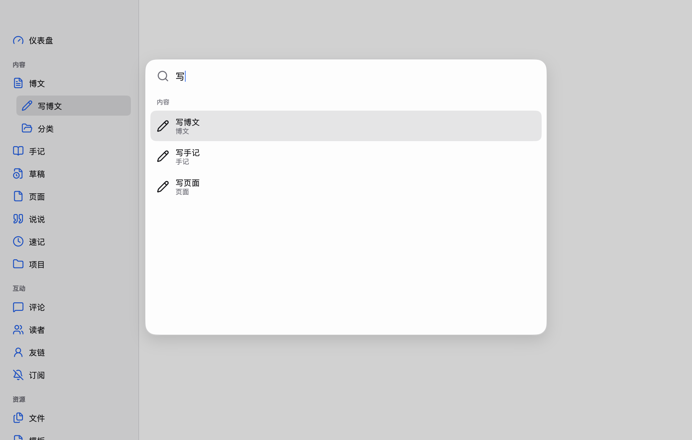
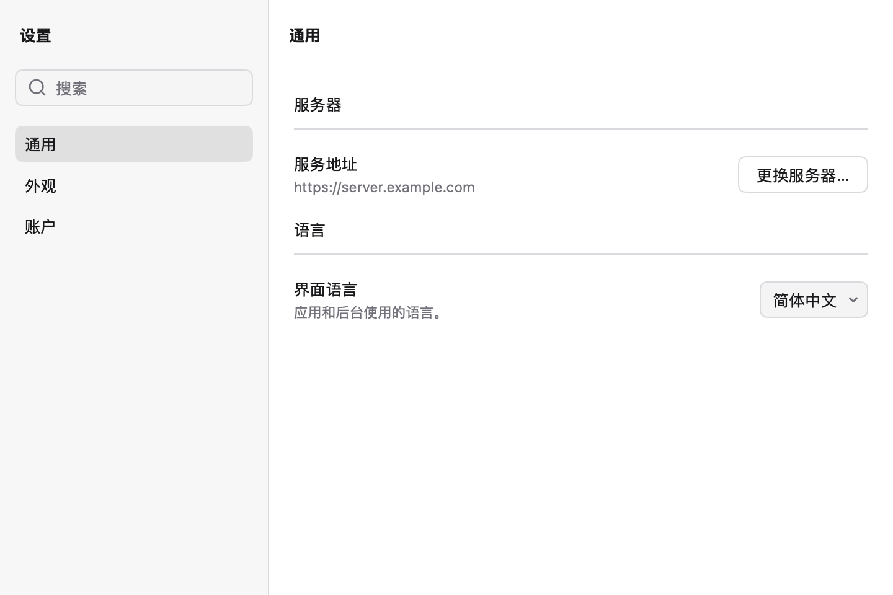
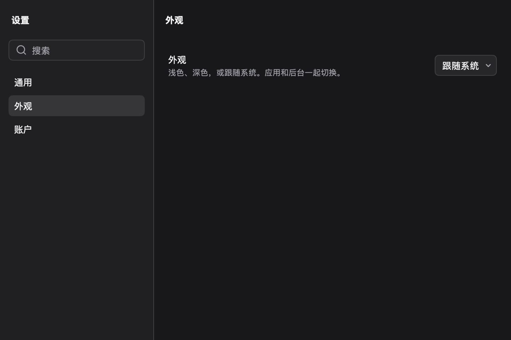
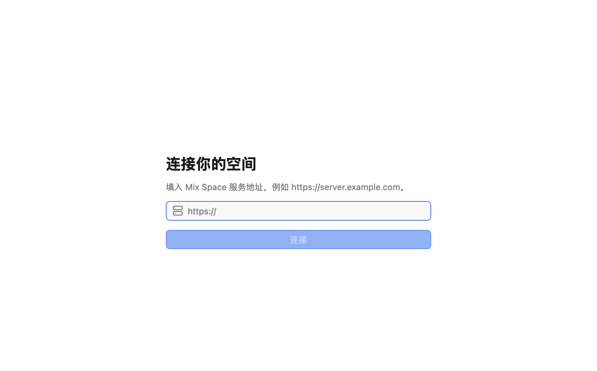
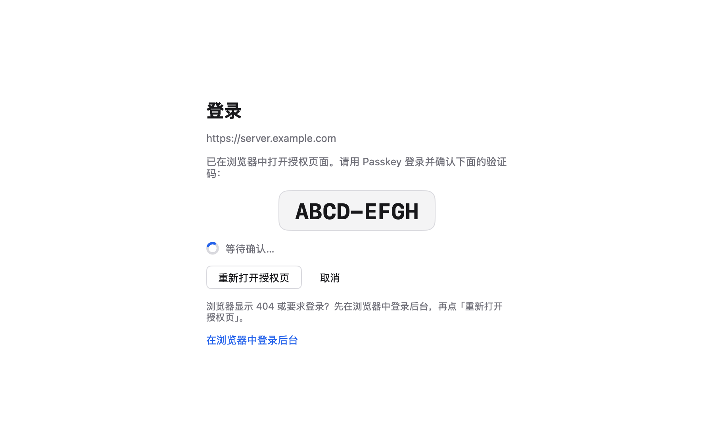

# Mix Space Desktop

Mix Space 后台的桌面客户端，基于 [MyGo](https://mygo.run) 和 [Onevra](https://github.com/oneo-me/onevra) 构建（版本都锁定在 `go.mod` 中）。

它是 Web 后台的原生外壳：窗口、侧边栏、菜单栏、命令面板和设置窗口是原生的，内容区就是服务端在 `/proxy/qaqdmin` 提供的 Web 后台，显示在 web view 里。客户端本身不实现后台功能，所以服务端升级后，桌面端无需发版就能用上新版后台。

优先支持 macOS，Windows 和 Linux 使用同一份代码构建。

<p align="center">
  
</p>

## 维护边界：不修改 mx-core 核心代码

这个应用作为 mx-core 的桌面客户端单独维护，**所有改动都限定在 `apps/desktop/` 目录内**，不修改 `apps/core`（服务端）、`apps/admin`（Web 后台）和共享包。

唯一的例外是 `.github/README.md`：它让 GitHub 仓库首页显示这份介绍（GitHub 优先显示 `.github/README.md`，所以根目录的 mx-core README 保持不动）。它由 `apps/desktop/README.md` 生成，不要直接编辑：改完 `apps/desktop/README.md` 后，在 `apps/desktop` 里运行 `go run ./internal/ghreadme`（`go generate` 也会运行它）。两份不一致时 `go test ./...` 会失败。

它只使用 mx-core 已经公开的能力，对它们只读、不改：

| 依赖的上游能力 | 位置 | 用途 |
| --- | --- | --- |
| Web 后台页面 `/proxy/qaqdmin` | `apps/core` pageproxy | 内容区的 web view |
| Better Auth `/auth/ok`、设备授权、`/device/web-handoff` | `apps/core` auth | 探测服务器、Passkey 登录、把令牌换成后台 Cookie |
| 设备客户端 `mxs-cli` | `apps/core/src/modules/auth/auth.constant.ts` | 服务端只接受白名单里的客户端，桌面端借用 CLI 的，所以授权页显示 “Mix Space CLI” |
| 路由元数据、中英文标题、Lucide 图标 | `apps/admin/src/views/**/page.tsx` | 生成原生侧边栏（`go generate`） |
| 存储键 `admin:sidebar-collapsed`、`theme-mode`、`mx-admin-ui-locale` 和两个 `aria-label` | `apps/admin` | 预加载脚本：收起 Web 侧边栏，同步外观和语言 |

上游变化时，在这里适配，不去改上游：

- 后台增删页面：在 `apps/desktop` 里运行 `go generate`（需要先 `pnpm install`），检查 `nav_gen.go` 和 `icons/` 的 diff。
- 后台改了存储键或 `aria-label`：更新 `bridge.go`。不更新的话，Web 侧边栏的按钮会重新出现，但不影响使用。
- 服务端改了认证接口：更新 `auth.go` 和 `server.go`。

如果某项功能确实需要服务端配合（比如给桌面端单独注册一个设备客户端），应当另向 mx-core 提 PR，不要放在这个应用的改动里。

## 功能

### 原生窗口与侧边栏

Onevra 的侧边栏外壳：macOS 上有标题栏材质，Windows 上有 Mica。侧边栏可以拖动调宽、折叠，从后台路由自动生成，并跟随当前页面高亮。标题栏显示面包屑，点击上级可以跳回去。

### 命令面板 `⌘K`

可以用中文、英文或路径搜到任意后台页面，也能执行刷新、前进后退、切换外观或语言、更换服务器、退出登录等操作。

`⌘K` 不是菜单快捷键，而是视图快捷键：后台编辑器自己绑定了 `⌘K`（插入链接），页面处理过的按键会留给页面。

### 设置 `⌘,`

<p align="center">
  
  
</p>

独立的可搜索设置窗口，包含服务地址、界面语言、外观（浅色、深色、跟随系统，应用和后台一起切换），以及账户相关的操作。

### 连接与登录

<p align="center">
  
  
</p>

- **密码**：在 web view 里使用后台自己的登录表单。
- **Passkey**：在系统浏览器中完成设备授权（`auth.go`），与 mxs CLI 和 iOS 客户端的方式相同。浏览器里用 Passkey 登录并确认验证码后，应用把会话令牌存进钥匙串，再通过 `/device/web-handoff` 换成后台的 Cookie。之后启动时如果 Cookie 已过期，会自动用钥匙串里的令牌重新登录。

连接失败、登录成功、失败或过期、退出登录，都会用 Toast 提示。

## 开发

需要 Go 1.27 及以上。

```sh
cd apps/desktop
go tool mygo dev     # 运行并热重载
go test ./...        # 测试，包括各界面的无界面渲染
go tool mygo build   # 生成 build/darwin-arm64/Mix Space.app 和 .dmg
```

截图是原生界面的无界面渲染（Web 后台部分留空）。界面改动后重新生成：

```sh
README_SCREENSHOTS=docs/screenshots go test -run TestReadmeScreenshots
```

`SCREENSHOTS=<dir> go test -run TestScreens` 会把测试里渲染的各个界面保存为 PNG，方便检查。

修改 `apps/desktop/README.md` 后，运行 `go run ./internal/ghreadme` 同步仓库首页的 `.github/README.md`。

## 代码结构

| 文件 | 内容 |
| --- | --- |
| `main.go` | 应用状态、连接、web view、登录流程 |
| `views.go` | 窗口外壳、侧边栏、标题栏面包屑，以及设置、登录、错误页 |
| `palette.go` | `⌘K` 命令面板 |
| `prefs.go` | `⌘,` 设置窗口 |
| `menu.go` | 菜单栏 |
| `bridge.go` | 注入 Web 后台的预加载脚本，以及 Go 端接口 |
| `auth.go` / `server.go` | 设备授权、令牌交换、服务器探测 |
| `nav.go` / `nav_gen.go` / `icons/` | 侧边栏数据（`nav_gen.go` 和 `icons/` 是生成的） |
| `internal/gennav` | 侧边栏生成器 |
| `internal/ghreadme` | 由 `README.md` 生成 `.github/README.md` |

主题使用 MyGo 默认主题，没有用 Onevra 的配色，这样原生部分和 Web 后台的观感更接近。
